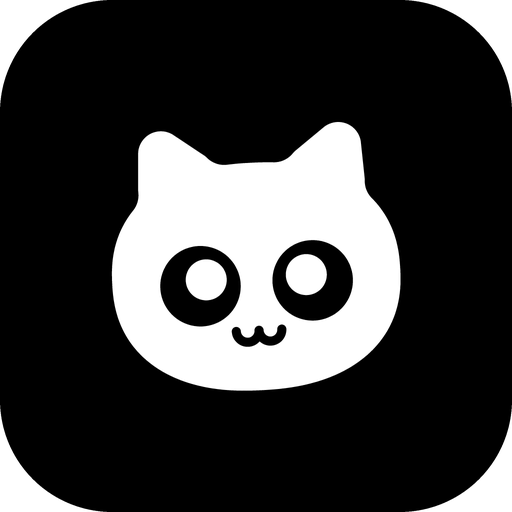
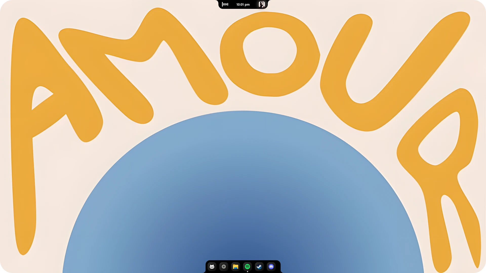
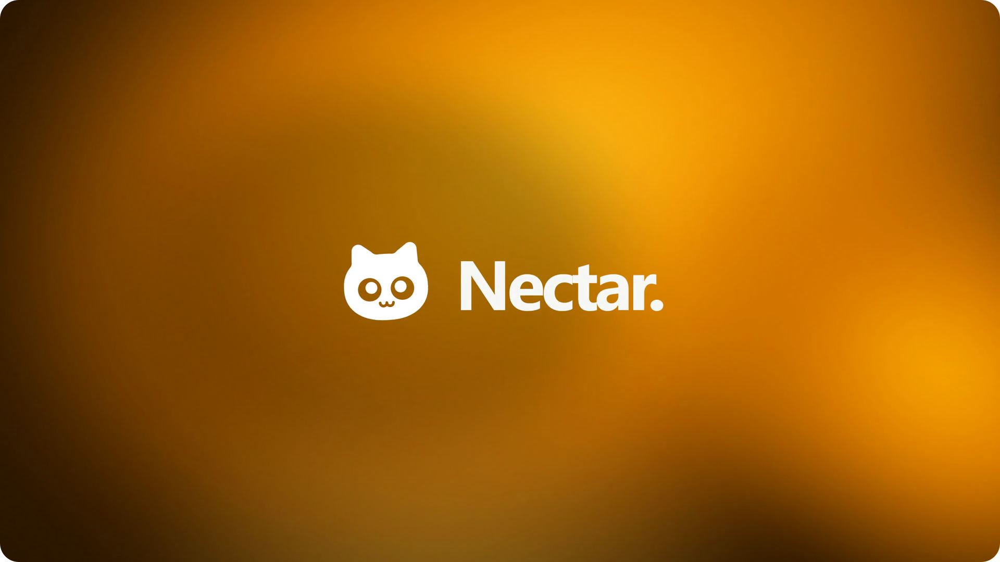

<div align="center">



<br />

<picture>
  <source media="(prefers-color-scheme: dark)" srcset="docs/wordmark-dark.png" />
  
</picture>

<p><strong>A notch and a dock for Windows.<br />Physics-animated, reactive, and built to replace your taskbar.</strong></p>

[](https://github.com/kua8/Nectar/releases/latest)
[](https://github.com/kua8/Nectar/releases)
[](LICENSE)
[](https://www.microsoft.com/windows)

[**Download**](https://github.com/kua8/Nectar/releases/latest) &nbsp;·&nbsp; [Features](#features) &nbsp;·&nbsp; [Install](#install) &nbsp;·&nbsp; [Settings](SETTINGS.md) &nbsp;·&nbsp; [Report a bug](https://github.com/kua8/Nectar/issues/new/choose)

<br />



<br /><br />

<a href="https://nectar.kua8.lol/trailer/">
  
</a>

[**▶ Watch Nectar in action**](https://nectar.kua8.lol/trailer/) · 40 seconds

</div>

<br />

> **Disclaimer:** I'm a solo dev and I really DID NOT expect this sudden traction for Nectar. I really appreciate the recent support, and I'm trying my best to release fixes as quickly as possible to keep you all happy. But fixing one issue often causes another one. So moving forward I'll do weekly releases with stable builds, plus a pre-release for smaller fixes, and a toggle to decide which version of Nectar you run. This gives me time to search through all the bugs, find the most critical ones, and also have a private life. Thank you for understanding.

## Features

| What you get | How |
| --- | --- |
| **A notch that does things** | Music, a Control Center you arrange yourself, status, a calendar and a file shelf in one spring-animated island. |
| **A dock that replaces your taskbar** | Mirrors your real taskbar, same pinned apps and order, with real icons and names. |
| **Native where it counts** | The tray opens the real Windows flyout, and Quit ends an app like Task Manager's End task. |
| **Out of your way** | Fixed, Smart or Peek modes, and both stay hidden over fullscreen games. |
| **Made for your setup** | Every monitor, one monitor, or a specific one. English and Turkish. Every option lives in a plain `settings.json`. |
| **Light on the system** | Audio capture, cursor tracking and thumbnail work pause themselves when nothing needs them. |

<div align="center">
<table>
  <tr>
    <td align="center"></td>
    <td align="center"></td>
  </tr>
  <tr>
    <td align="center"><sub>The notch</sub></td>
    <td align="center"><sub>The dock</sub></td>
  </tr>
</table>
</div>

## Install

1. Download the installer from the [latest release](https://github.com/kua8/Nectar/releases/latest).
2. Choose **Just me** or **All users**. An all-users install asks for administrator permission once.
3. Nectar starts with a short splash, then the notch and dock appear together.

Nectar updates itself: a green dot on the notch means an update is ready, and **Auto Update** in **Settings › About** installs it for you. Turn on **Get pre-releases** there to receive early builds before the weekly release. **Uninstall** from Windows Settings › Apps or from **Settings › About**, either puts your taskbar back.

<details>
<summary>Verify your download</summary>

<br />

Only download Nectar from the [releases page](https://github.com/kua8/Nectar/releases) of this repository. Each release has a `SHA256SUMS.txt`. Compare the output of this command with the matching line:

```powershell
Get-FileHash .\Nectar-Setup-<version>.exe -Algorithm SHA256
```

</details>

## Usage

**Notch panels.** Scroll or swipe on the notch to change panel.

| Panel | What it does |
| --- | --- |
| **Music** | Album art, track info, playback controls, a visualizer, and a switch between several playing apps. |
| **Control Center** | Wi-Fi, Bluetooth, Do Not Disturb, volume and brightness. Drag tiles, buttons and sliders into your own layout. |
| **Status** | Battery (hidden on desktops without one) and weather, in a layout you choose. |
| **Calendar** | Day, week, month and agenda views, a timer, a stopwatch and Pomodoro. |
| **Shelf** | Drop files or text on the notch and drag them out later. |

**Visibility modes.** The notch and the dock each have their own.

| Mode | Behavior |
| --- | --- |
| **Fixed** | Always visible. The dock reserves screen space like a normal taskbar. |
| **Smart** | Hides when another window overlaps it and reveals on hover. |
| **Peek** | Hidden until the cursor reaches the screen edge, or a media event arrives. |

In Smart and Peek both stay hidden, and click-through, while a fullscreen app is in front.

**Multiple monitors.** Under **Show On**, pick **Primary Monitor** (the default), **All Monitors** or a **Specific Monitor** for the dock and the notch separately. Each extra monitor gets its own windows, so **All Monitors** uses more memory than a single display.

## Troubleshooting

<details>
<summary><b>The dock shows over my game</b></summary>

<br />

Nectar hides the dock and notch over a fullscreen window that covers the whole monitor, in Smart and Peek. Fixed mode stays visible by design. If something still appears, open an issue with the game and its display mode (fullscreen, borderless or windowed).

</details>

<details>
<summary><b>The Windows taskbar did not come back</b></summary>

<br />

Start Nectar again, it restores the taskbar on launch even after a crash. Uninstalling from Windows Settings › Apps or from **Settings › About** brings it back too.

</details>

<details>
<summary><b>Nectar uses a lot of memory</b></summary>

<br />

Every window runs in its own WebView2 process, so each monitor adds a notch and a dock. Set **Show On** to one monitor to cut it down.

</details>

<details>
<summary><b>Brightness does not change on my external monitor</b></summary>

<br />

External monitors are controlled over DDC/CI. Turn DDC/CI on in the monitor's own menu, and connect it directly if you use a dock or adapter, since some do not pass it on.

</details>

<details>
<summary><b>Something else is broken</b></summary>

<br />

Open **Settings › About › Copy Diagnostics** and paste the result into a [bug report](https://github.com/kua8/Nectar/issues/new/choose). It includes your versions, monitors and recent log.

</details>

## Build from source

You need [Rust](https://rustup.rs/) and [Bun](https://bun.sh/) on Windows.

```bash
git clone https://github.com/kua8/Nectar.git
cd Nectar
bun install
bun run tauri dev
```

`bun run tauri build` makes a release build. Before a pull request, read [CONTRIBUTING.md](CONTRIBUTING.md).

## Roadmap

These are ideas under consideration, not promises.

- [ ] Background tray programs (antivirus, VPN) in the notch
- [ ] Lower memory use, with Settings loaded on demand
- [ ] Code signing for the installer
- [x] Stable and pre-release update channels
- [x] Multiple media sessions, Task Manager in the dock menu, show desktop corner

See the [open issues](https://github.com/kua8/Nectar/issues) for requests and known bugs.

## Built with

[](https://tauri.app/)
[](https://www.rust-lang.org/)
[](https://react.dev/)
[](https://www.typescriptlang.org/)
[](https://vitejs.dev/)

## Support

Nectar is free and open source. If it makes your desktop nicer, you can support its development.

[](https://buymeacoffee.com/kua8)

## License

Nectar is open source under the [GPLv3](LICENSE).

## Credits

Nectar began as a fork of [Bloom](https://github.com/SehajveerSingh2005/bloom) by Sehajveer Singh, and the original concept and the codebase it grew from are theirs. Nectar has since been rebuilt and is maintained independently, with its own features, fixes and direction. Thanks to everyone listed on the [contributors page](https://github.com/kua8/Nectar/graphs/contributors).
